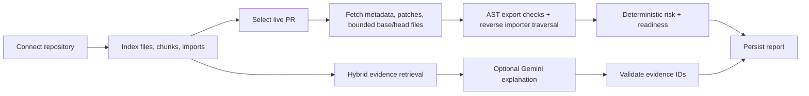
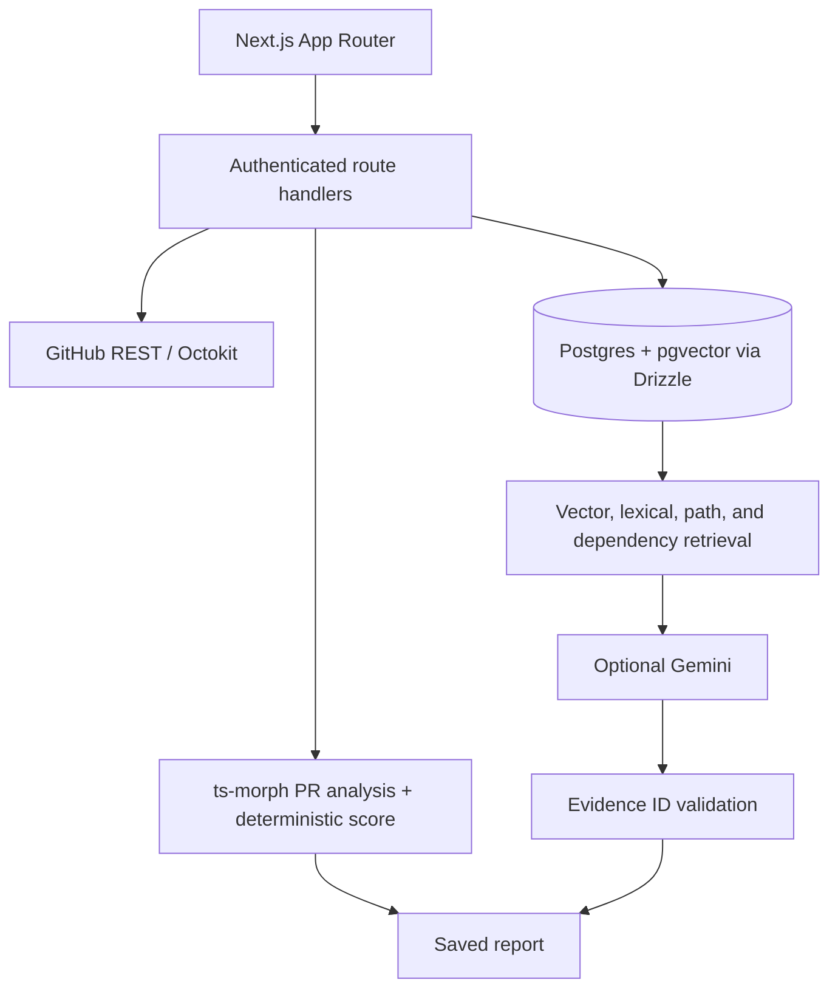

# ImpactGraph

**A GitHub pull request impact analyzer that connects changed code to repository structure, evidence, and review actions.**

ImpactGraph helps an engineer investigate what a pull request changed, which indexed modules import the affected code, what exported TypeScript/JavaScript contracts changed, which tests may be relevant, and what evidence is still missing. It combines deterministic static checks with optional Gemini explanations. It is a review assistant; it does not approve or merge pull requests.

## Why it exists

Pull request diffs show edited lines, but consequences often appear in consumers, shared types, tests, or critical paths elsewhere. ImpactGraph brings live GitHub changes together with an indexed repository view and explains both its findings and its uncertainty.

## Feature status

| Feature | Status |
| --- | --- |
| GitHub integration | Live PR metadata, up to 200 commit records, and paginated file listing. Optional server-level token; per-user GitHub OAuth/App and user-authorized private access are not implemented. |
| Diff analysis | Actual GitHub patch/status/counts; base/head source fetched for up to 20 TS/JS files. Large PR/file analysis may be incomplete. |
| Dependency analysis | `ts-morph` import extraction and bounded reverse file-graph traversal from indexed snapshot. Symbol/runtime impact remains partial. |
| Breaking-change detection | Partial TS/JS exported declaration shape and signature comparison; potential findings, not full-program type checking. |
| Risk scoring | Deterministic weighted score for live PRs with visible factors and merge-readiness rules. Heuristic, not incident probability. |
| Test impact analysis | Name/content-based test suggestions; no coverage measurement or automatic execution. |
| AI explanations | Optional Gemini explanation grounded to retrieved chunks; evidence ID validation; deterministic PR result can persist without AI. |
| CI/CD integration | Not implemented. No check-run, workflow, or deployment status ingestion. |

## Screenshots

No product screenshots are currently checked into the repository. Capture these views after configuring a working local environment: authenticated dashboard, PR selection, report merge-readiness panel, dependency map, and detailed static finding. No placeholder images are presented as real product screens.

## How analysis works



The report includes actual changed files and patches where GitHub provides them, potential exported API changes, indexed consumers, likely test recommendations, a weighted risk breakdown, evidence gaps, and actions to review. A valid evidence citation confirms that a chunk was supplied to the model; it does not prove the conclusion.

## Architecture



Primary modules: `src/lib/github.ts`, `src/lib/static-analysis.ts`, `src/lib/pr-impact.ts`, `src/lib/retrieval.ts`, `src/lib/grounding.ts`, `src/lib/analysis.ts`, and `src/db/schema.ts`. More detail: [architecture](docs/ARCHITECTURE.md), [analysis engine](docs/ANALYSIS_ENGINE.md), and [dependency model](docs/DEPENDENCY_ANALYSIS.md).

## Risk and merge readiness

The live PR score is calculated in application code from change complexity, indexed importer impact, detected contract changes, a test-discovery signal, and a critical-path name heuristic. Default weights are 20%, 25%, 25%, 15%, and 15%. Configurable weights, equations, examples, and interpretation are documented in [RISK_SCORING.md](docs/RISK_SCORING.md). Score bands are Low (0–20), Moderate (21–40), High (41–70), and Critical (71–100).

Merge readiness includes severity counts and whether patch/source evidence is complete. Unknown or unsupported evidence is not scored as proof of safety. `LOW RISK` is not approval. The system never approves or merges a PR.

## Technology

- Next.js 16 App Router, React 19, TypeScript
- PostgreSQL, pgvector, Drizzle ORM
- Octokit REST API
- `ts-morph` for TypeScript/JavaScript AST extraction
- Gemini for embeddings and optional evidence-grounded explanations
- Google OAuth for ImpactGraph sign-in

## Setup

Prerequisites: Node.js compatible with the installed Next.js version, PostgreSQL with pgvector, and (for enabled features) Google OAuth and Gemini credentials. Public GitHub API access works without a token at a lower rate limit.

Create `.env.local` in the repository root:

```env
DATABASE_URL=your-postgres-connection-string
GITHUB_TOKEN=optional-server-side-github-token
GEMINI_API_KEY=your-gemini-api-key
GEMINI_ANALYSIS_MODEL=gemini-3.6-flash
GOOGLE_CLIENT_ID=your-google-client-id
GOOGLE_CLIENT_SECRET=your-google-client-secret
APP_URL=http://localhost:3000
# Optional score weights as fractions; values are normalized together.
RISK_WEIGHT_COMPLEXITY=0.20
RISK_WEIGHT_DEPENDENCIES=0.25
RISK_WEIGHT_BREAKING=0.25
RISK_WEIGHT_TESTS=0.15
RISK_WEIGHT_CRITICALITY=0.15
```

Set up Google OAuth with origin `http://localhost:3000` and redirect URI `http://localhost:3000/api/auth/google/callback`. `GITHUB_TOKEN` is a server-wide token, not a per-user OAuth connection. Do not commit environment files or expose secrets with `NEXT_PUBLIC_` variables.

Install, migrate using the project's configured database workflow, and run locally:

```powershell
npm install
npx drizzle-kit migrate
npm run dev
```

Open `http://localhost:3000`, sign in, connect a repository, complete indexing and embedding backfill, then select a PR from `/analyze`. No GitHub, OAuth, database, or Gemini credentials are included in this repository.

## Verification

```powershell
npx.cmd tsc --noEmit
npm.cmd run lint
npm.cmd run test:grounding
npm.cmd run test:pr-impact
npx.cmd drizzle-kit check
npm.cmd run build
```

These local checks do not verify live OAuth, real GitHub access, model quota, database connectivity, or an end-to-end browser workflow. Tests recommended in a saved PR report are not executed by ImpactGraph.

## Security and data flow

Application users authenticate through Google. Repository operations are scoped by the user's stored repository ownership. GitHub, Google, Gemini, and database credentials remain server-side. Repository source may be sent to Gemini when that optional feature is configured. Repository text is untrusted and prompt-injection instructions are treated as data, but this is not a formal security guarantee. See [SECURITY.md](docs/SECURITY.md).

## Repository layout

```text
src/app/        Next.js pages and API route handlers
src/components/ UI components, report graph, onboarding
src/db/         Drizzle schema and database connection
src/lib/        GitHub, ingestion, retrieval, AST, risk, auth, AI
src/prompts/    Structured AI explanation prompt
drizzle/        Additive SQL migrations
docs/           Architecture, analysis, security, and interview notes
```

## Known limitations

Private GitHub access is limited to the configured server token; analysis is bounded to 100 PR files and 20 TS/JS source pairs; static analysis is not a full type checker; other languages are unsupported for semantic analysis; test recommendations do not measure coverage; no tests are run on the user's repository; background jobs, CI integration, and historical regression intelligence are not implemented. See [KNOWN_LIMITATIONS.md](docs/KNOWN_LIMITATIONS.md).

## Roadmap

1. GitHub App installation and per-user private repository authorization.
2. Background jobs and incremental PR-head indexing with persistent progress.
3. Full-program head-revision type checking and richer symbol-level consumer analysis.
4. Explicitly configured test/CI result integration and measured coverage.
5. Historical regression context and useful analysis trend views.

## Documentation

- [Project overview](docs/PROJECT_OVERVIEW.md)
- [Architecture](docs/ARCHITECTURE.md)
- [Analysis engine](docs/ANALYSIS_ENGINE.md)
- [Dependency analysis](docs/DEPENDENCY_ANALYSIS.md)
- [Risk scoring](docs/RISK_SCORING.md)
- [Breaking changes](docs/BREAKING_CHANGES.md)
- [Test impact](docs/TEST_IMPACT_ANALYSIS.md)
- [AI reasoning](docs/AI_REASONING.md)
- [Security](docs/SECURITY.md)
- [Architecture decisions](docs/DECISIONS.md)
- [Interview preparation (46 questions)](docs/INTERVIEW_PREPARATION.md)
- [Development log](docs/DEVELOPMENT_LOG.md)
- [Changelog](docs/CHANGELOG.md)
