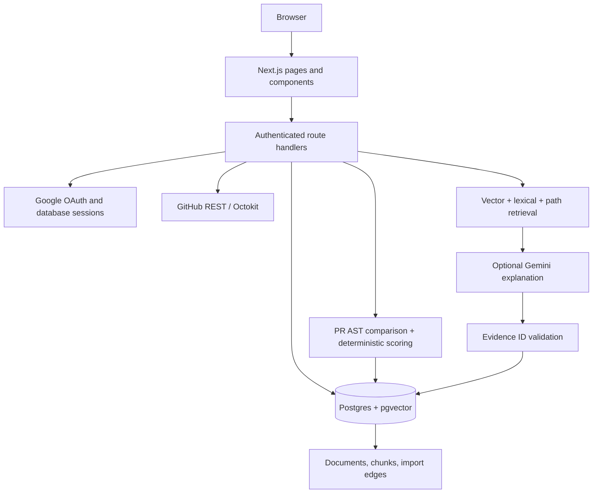
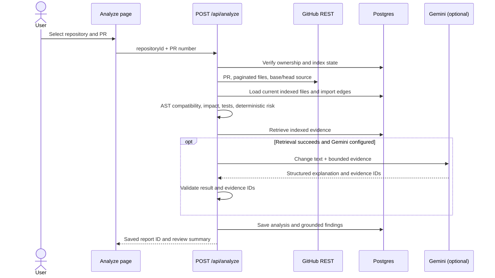

# Architecture

ImpactGraph is a Next.js 16 App Router application with server route handlers, React client pages, Postgres through Drizzle, GitHub REST through Octokit, and Gemini for optional explanation and embeddings.

## Frontend

Server-rendered App Router pages provide the application shell; client components handle onboarding, analysis submission, report loading, re-run navigation, theme selection, and the dependency map. `/analyses/[id]` displays the persisted review details, not a live recomputation.

## Backend and data flow

Route handlers call server-only libraries, validate inputs, and scope repository and analysis queries through the signed-in user's ID. `src/db/schema.ts` describes users, sessions, repositories, documents, chunks, import edges, analyses, findings, evidence, and evaluation records. Additive migrations live in `drizzle/`.

Repository indexing stores current source documents and chunks and updates `file_dependencies` using `ts-morph`. PR analysis fetches live GitHub metadata and changed files, then reads up to 20 source files at base/head revisions. It reuses the indexed source and import data for consumer/test hints. Results are persisted in `analyses.review_details`; the existing findings/evidence tables continue to hold model findings.

## External access and security boundary

Google OAuth establishes the application user identity; it does not authorize GitHub access. GitHub requests use the optional server-level `GITHUB_TOKEN`, or unauthenticated public API access. Private repository access is possible only when that configured token itself has access. See [SECURITY.md](SECURITY.md).
