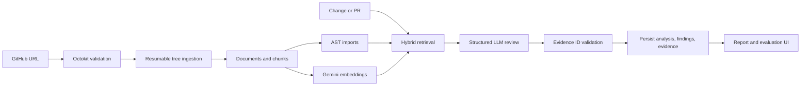
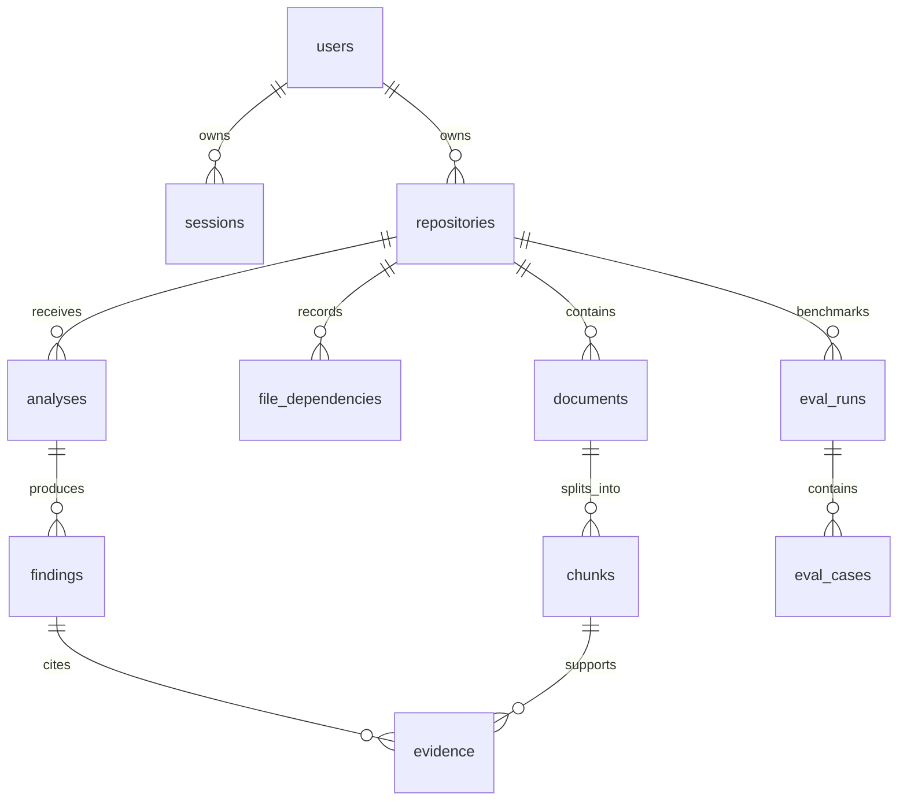

# ImpactGraph explained

This document describes the implementation that exists in this repository. It
is written as a study guide, not as a promise that the system can find every
bug. The application is an evidence-first code-impact analysis tool: it helps a
developer decide what to inspect before merging a change.

## One-minute pitch

ImpactGraph accepts a public GitHub repository, indexes supported files into
documents and structure-aware chunks, stores import relationships, generates
1536-dimensional embeddings, and retrieves relevant context for a change. An
LLM produces a structured review, but a finding is marked verified only when
its cited evidence IDs match the retrieved chunks. The result is persisted so
the report can be inspected later.

## End-to-end workflow



## Architecture map

- `src/app/page.tsx`: public product explanation and sign-in entry point.
- `src/app/dashboard/page.tsx`: authenticated repository workspace.
- `src/components/repository-onboarding.tsx`: connects repositories and runs
  the real indexing and embedding endpoints.
- `src/app/analyze/page.tsx`: change description, open PR, and merged PR input.
- `src/app/analyses/[id]/page.tsx`: evidence-first report with grounded-only
  filtering, copyable URL, evidence rail, and impact-map fallback.
- `src/components/impact-map.tsx`: SVG visualization using stored dependency
  edges only; without edges it renders a ranked file list.
- `src/lib/github.ts`: URL validation, repository/tree/file/PR access.
- `src/lib/ingestion.ts`: supported-file filtering and classification.
- `src/lib/static-analysis.ts`: TypeScript-aware symbols and import edges.
- `src/lib/chunking.ts`: function/class/section/PR/issue chunk creation.
- `src/lib/embeddings.ts`: Gemini embedding calls with 1536 dimensions.
- `src/lib/retrieval.ts`: semantic, lexical, changed-file, dependency, and
  recency signals combined into a ranked result.
- `src/lib/analysis.ts`: strict validation of the model's JSON shape.
- `src/prompts/impact-analysis.ts`: evidence-bounded review instructions.
- `src/lib/grounding.ts`: exact evidence-ID verification.
- `src/app/api/analyze/route.ts`: orchestration and persistence.
- `src/app/api/analyses/[id]/route.ts`: ownership-protected report retrieval.
- `src/db/schema.ts`: operational, review, evaluation, user, and session data.
- `drizzle/`: additive migration history.
- `middleware.ts` and `src/lib/auth.ts`: route protection, Google OAuth, and
  hashed sessions.

## Repository indexing

The repository URL is restricted to `github.com` and exactly an owner and
repository path. The server asks GitHub for repository metadata, rejects private
repositories in the current product, obtains the branch tree, filters files,
and processes batches. `repositories.indexing_cursor` is the checkpoint. A
request can stop after a batch and resume from that cursor. A document with the
same repository, path, and SHA is skipped, so retrying does not regenerate
unchanged source.

Each supported file becomes a `documents` record. Source files are split around
symbols discovered by the static analyzer; Markdown is split around headings;
PRs and issues become context chunks. `file_dependencies` stores source/imported
path pairs extracted from imports. The current implementation caps the tree to
3,000 eligible files and processes 75 files per indexing request.

## Embeddings and pgvector

An embedding is a numeric representation of text. Similar programming ideas
can be close in vector space even when they use different words: “reject an
expired session” and “invalidate stale login cookies” may be semantically
related. ImpactGraph requests 1,536-dimensional Gemini embeddings and stores
them in `chunks.embedding` using PostgreSQL `vector(1536)`.

Vector similarity is a retrieval signal, not proof. It can surface relevant
context, but a retrieved chunk may still fail to support a particular claim.
That is why the report keeps retrieval score, model confidence, and grounding
status separate.

## RAG from first principles

Retrieval-Augmented Generation has two jobs: retrieve relevant information from
a knowledge source, then generate an answer constrained by that context. Here,
the knowledge source is the indexed repository. Retrieval combines:

1. semantic vector candidates;
2. PostgreSQL English full-text candidates;
3. exact changed-file candidates for PRs;
4. stored dependency-neighborhood signals; and
5. a small recency signal for historical documents.

The weighted score is currently semantic 0.45, lexical 0.30, structural 0.15,
and recency 0.10. The top 20 chunks are passed to the model. Relevance means
“this chunk may help”; grounding means “the finding cited a retrieved chunk and
all of its cited IDs were valid.” Those are deliberately different states.

Repository content is untrusted data. The prompt tells the model not to follow
instructions contained in source, comments, or documentation, and the server
does not treat model output as authority over database operations.

## How a PR is reviewed

For a PR, the API fetches the real title, body, and changed filenames from
GitHub. It builds a query from that material and gives the changed paths a
retrieval signal. The model receives evidence IDs, paths, chunk types, and
content. Its JSON is validated for a 0–100 integer score, an array of findings,
numeric confidence, reasons, and string evidence IDs.

Every finding is persisted whether its score is low or high. The score never
gates review generation. A clean or low-risk review remains useful because it
records what was checked and what remains uncertain; it does not fabricate
positive findings merely to fill space.

If a model response is malformed, the request fails instead of saving a fake
clean report. If a finding cites an unknown ID, the unknown ID is excluded and
the finding remains unverified. A verified finding requires at least one valid
ID and no invalid IDs.

## Risk, confidence, and evidence

- **Risk score** is the model's 0–100 overall estimate; it is not calibrated
  probability.
- **Finding confidence** is the model's confidence in one finding.
- **Retrieval score** describes ranking relevance.
- **Evidence verification** describes whether cited IDs map to supplied chunks.
- **Severity** is an interpretation of what the impact type means; the current
  schema stores impact type but does not have a separate calibrated severity.

A score of zero does not prove zero defects. It means the model assessed low
likely impact using the available context. Missing or stale indexing can make a
review incomplete.

## Evidence and grounding

Evidence rows connect a finding to a document and chunk, while storing a short
excerpt and retrieval score. Source paths and chunk line metadata are used for
GitHub links when a revision is available. A claim may still be weak even when
its ID is valid: the chunk can be relevant but not decisive. The UI therefore
labels verified and unverified claims differently and supports a Grounded only
filter.

## Dependency map

Nodes are file paths involved in stored findings or stored dependency edges.
Edges are only drawn from `file_dependencies`; the UI never creates an edge
because two files happened to be retrieved together. When there are no relevant
edges, the report shows a ranked file-impact list instead. This is less flashy,
but it is honest.

## Database model



`repositories` stores GitHub identity and indexing state. `documents` stores
source, PR, issue, and documentation content. `chunks` stores retrievable
segments and vectors. `analyses`, `findings`, and `evidence` persist review
results. `eval_runs` and `eval_cases` store resumable retrieval benchmarks.
`users` and `sessions` support Google authentication. Migration `0003` adds
users, sessions, and nullable repository ownership without deleting old data.

## Evaluation metrics

- Recall@5: the fraction of benchmark cases where an expected changed file is
  present in the first five predictions.
- Recall@10: the same calculation over ten predictions.
- MRR: the mean of reciprocal first-hit ranks. A first result contributes 1.0;
  a third result contributes 0.333; a miss contributes 0.
- Grounding rate: verified findings divided by findings with grounding checks.

These metrics measure retrieval and citation behavior, not overall software
quality. The evaluator processes up to five cases per batch and persists a
cursor so an interrupted run can resume.

## Frontend workflow

`/` explains the product and starts Google sign-in. `/dashboard` owns the
repository workspace. `/analyze` offers a description, open PR, or merged PR
mode. `/analyses/[id]` renders the persisted review. `/eval` starts and lists
evaluation runs; `/eval/[runId]` shows cases and metrics.

The shell includes a light/dark toggle. It stores `impactgraph-theme` in
localStorage, otherwise follows the OS preference, and initializes the document
before hydration to reduce theme flashes. Reduced-motion users do not receive
animated transitions from the theme system.

## Security and failure handling

Google OAuth uses a signed state cookie, server-side code exchange, stable Google
subject IDs, and hashed random session tokens. Protected APIs require the
current session and join resources to the authenticated user's repository.
Secrets are server-only. GitHub URLs are restricted to GitHub. Errors returned
to the browser are concise; server logs retain only operational diagnostics.

The current application does not implement a general-purpose rate limiter, a
background queue, or full repository sandboxing for every possible language.
It relies on file caps, supported-file filtering, GitHub API behavior, and
server-side limits. Those are real limitations, not hidden guarantees.

## Setup and debugging

Requirements are Node.js, npm, PostgreSQL with pgvector, a GitHub token, and a
Gemini API key for embeddings and structured review generation. Copy
`.env.example` to a local environment file and fill values.

```powershell
npm install
npx.cmd drizzle-kit migrate
npm run dev
npx.cmd tsc --noEmit
npm run lint
npm run build
```

Open `http://localhost:3000`, sign in, connect a public repository, wait for
indexing and embeddings, then open Analyze. If the report says no evidence was
found, inspect indexing status and embedding quota before retrying. If OAuth
fails, verify `APP_URL`, the Google authorized redirect URI, and the presence
of the additive auth migration.

## Interview questions and answers

1. **Why does this project exist?** It reduces the gap between changing code
   and knowing which other code may need review before merge.
2. **What is the end-to-end flow?** Validate GitHub, index files, chunk and
   embed them, retrieve context, generate a review, verify citations, persist,
   and render.
3. **Why use RAG instead of one large prompt?** Retrieval limits context to
   relevant repository material and makes citations possible.
4. **What is an embedding?** A vector representation used to compare semantic
   similarity; it does not prove correctness.
5. **Why chunk files?** Symbol or heading chunks are easier to retrieve and fit
   the context budget better than entire repositories.
6. **What is hybrid retrieval?** Combining vector, lexical, changed-file, and
   structural signals rather than trusting one ranking method.
7. **Why PostgreSQL and pgvector?** They keep operational records and vector
   retrieval in one durable system with familiar SQL relationships.
8. **What is a dependency edge?** A stored source/imported path relationship
   extracted from repository imports.
9. **Why does the graph have a fallback?** Drawing edges without stored
   dependency evidence would mislead users.
10. **What is Recall@5?** Whether expected changed files appear among the first
    five ranked predictions, averaged over benchmark cases.
11. **What is MRR?** It rewards the rank of the first correct result using its
    reciprocal, so earlier hits matter more.
12. **What is grounding?** Checking that every cited evidence ID belongs to the
    exact retrieved set supplied to the model.
13. **Can valid evidence still be weak?** Yes. ID validity proves provenance,
    not that the excerpt fully proves the claim.
14. **How is prompt injection handled?** Repository text is marked as untrusted
    data and model output cannot directly execute tools or mutate the database.
15. **How is source revision consistency handled?** File documents retain SHA
    metadata, and unchanged path-plus-SHA files are skipped on reindexing.
16. **Why are APIs server-side?** They keep provider secrets and authorization
    checks away from browser-controlled requests.
17. **How does authorization work?** The session identifies a user, and queries
    join requested records through a repository owned by that user.
18. **Why are sessions hashed?** A database leak should not directly reveal a
    reusable bearer token.
19. **How does resumable indexing work?** The repository cursor records the next
    file batch, so failures can continue without rebuilding completed work.
20. **What happens on provider failure?** The request returns an actionable
    error, while already persisted batches remain available for retry.
21. **Why is the risk score not a probability?** It is a model-produced ordinal
    estimate and has not been calibrated against enough labeled outcomes.
22. **Why review a score of zero?** Low estimated risk can still hide missing
    context, so the review records limitations and remains inspectable.
23. **How would you test an LLM pipeline?** Unit-test parsing, grounding,
    ranking, and metrics deterministically; isolate live provider tests.
24. **What is the biggest performance cost?** GitHub calls, embedding batches,
    and model calls dominate; resumability prevents repeating completed work.
25. **What is the biggest security boundary?** Untrusted repository content is
    data, while the server owns credentials, authorization, persistence, and
    tool decisions.
26. **What is a false positive?** A plausible concern that does not reproduce;
    evidence and confidence help reviewers prioritize verification.
27. **What is a false negative?** A real impact absent from the report, often
    caused by missing indexing, weak retrieval, or model uncertainty.
28. **What would you improve next?** Add calibrated historical outcome labels,
    stronger revision-aware evidence, and a queue for long-running indexing.

## Interview cheat sheet

Remember: ImpactGraph is not “an LLM reading a repository.” Its strongest
engineering contribution is the chain from stored repository structure to
retrieved evidence to validated citations. The most important trade-off is
honesty over coverage: an unverified lead or a ranked fallback is preferable to
an invented dependency or fabricated source link. Before making a claim in an
interview, inspect the exact route and migration in this repository and state
which parts were verified locally versus dependent on GitHub, Google, Gemini,
Google Gemini, or Supabase credentials.

## Latest implementation notes

The authenticated workspace now uses a compact shared sidebar in
`src/components/app-shell.tsx`. The real routes are Connect (`/` for an
authenticated user, `/dashboard` as the explicit workspace), Analyze,
Reports (`/analyses`), Evaluation, and Evaluation Detail. The public version of
`/` remains an explanation and sign-in entry point, so an anonymous visitor
cannot connect a repository or inspect a report.

The theme tokens are defined once in `src/app/globals.css`. The inline
pre-hydration script in `src/app/layout.tsx` chooses the saved
`impactgraph-theme` value before React paints; if no value exists it follows the
operating-system preference. The toggle is keyboard accessible and the global
reduced-motion rule removes nonessential animation.

### Revision-aware source data

`documents.current_revision` is an additive field from
`drizzle/0004_revision_and_recall.sql`. When a tracked source path receives a
new GitHub SHA, the old document remains available for historical evidence but
is marked non-current. Retrieval only searches current source revisions. At a
complete, non-truncated indexing pass, deleted source paths and stale import
edges are marked out of the active set. This preserves old report provenance
without allowing stale code to rank as current evidence.

### Review details and score-zero behavior

The model response now contains an assessment, evidence-supported strengths,
recommendations, limitations, risk score, and findings. These details are
stored in `analyses.review_details` by migration
`drizzle/0005_review_details.sql`. A low or zero risk score is only an output;
it never controls whether generation happens. A provider failure or malformed
response returns an error and is not saved as a clean review. A successful
zero-finding review still has an assessment and limitations so it is visibly
different from a failed analysis.

### Evaluation metric correction

Evaluation cases now store fractional `recall_at_5` and `recall_at_10` values.
For example, if a PR changed four files and two occur in the first five
retrieved paths, that case contributes `0.50` to Recall@5. A boolean hit is kept
for compatibility, but it is not used as the recall metric. MRR remains the
reciprocal rank of the first expected path, and grounding rate is the count of
fully verified findings divided by all generated findings. The trend chart is
rendered only from real completed runs and shows no sample data.

### Security additions in this pass

The indexing error recovery update is now scoped to the authenticated owner,
repository connection checks only the current user's existing connection,
evaluation continuation verifies both run ownership and repository identity,
and retrieval inspection verifies repository ownership before querying. The
application sends common browser security headers from `next.config.ts`.
The provider keys remain server-only. npm advisory scanning still depends on
network access to the npm registry and must be run in a networked environment.
